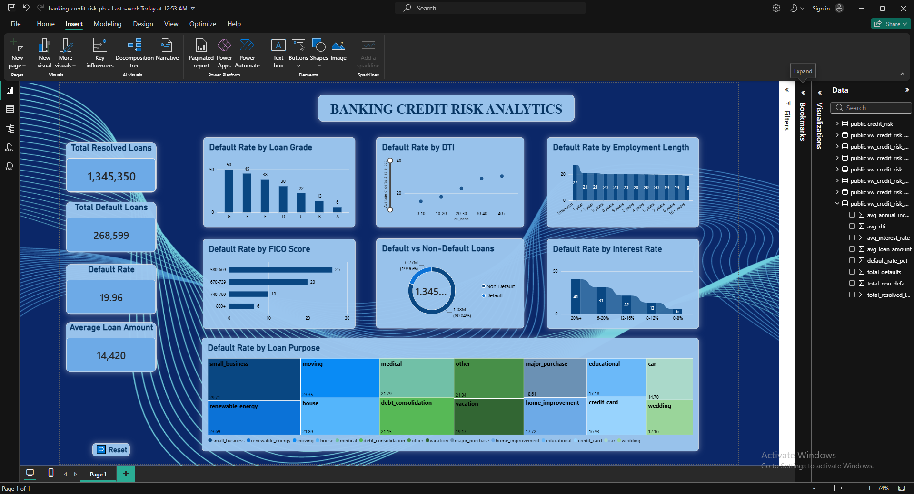

# Banking Credit Risk Analytics

An end-to-end credit risk analysis of **1.34 million resolved LendingClub loans**, built with **Python, PostgreSQL, and Power BI**. The project turns raw loan-level data into a reusable SQL layer and an interactive dashboard that shows how default rates vary across borrower and loan characteristics.


---

## Dashboard Preview



---

## Table of Contents

- [Project Overview](#project-overview)
- [Business Objectives](#business-objectives)
- [Tech Stack](#tech-stack)
- [Dataset](#dataset)
- [Methodology](#methodology)
- [Key Metrics](#key-metrics)
- [Key Findings](#key-findings)
- [SQL Analytical Layer](#sql-analytical-layer)
- [Power BI Dashboard](#power-bi-dashboard)
- [Repository Structure](#repository-structure)
- [How to Reproduce](#how-to-reproduce)
- [Limitations](#limitations)
- [Conclusion](#conclusion)
- [Author](#author)

---

## Project Overview

Lenders need to know which borrower and loan characteristics are associated with higher default risk. This project analyzes LendingClub loan data to:

- quantify the overall default rate,
- compare default rates across grade, interest rate, DTI, FICO score, loan purpose, and employment length, and
- present the results in a dashboard that supports data-driven lending decisions.

## Business Objectives

| # | Objective |
|---|---|
| 1 | Measure the overall loan default rate |
| 2 | Analyze default patterns across loan grades and interest rate bands |
| 3 | Understand the relationship between debt-to-income (DTI) ratio and default |
| 4 | Evaluate credit risk across FICO score ranges |
| 5 | Compare default rates by loan purpose and employment length |
| 6 | Deliver the findings through an interactive Power BI dashboard |

## Tech Stack

| Layer | Tools |
|---|---|
| Data preparation | Python, Pandas, NumPy, Jupyter Notebook |
| Database | PostgreSQL |
| SQL techniques | Aggregations, `CASE` statements, `FILTER` conditional counts, CTEs, analytical views |
| Visualization | Microsoft Power BI |
| Version control | Git, GitHub |

## Dataset

| Attribute | Detail |
|---|---|
| Source | LendingClub accepted loans, 2007–2018 Q4 |
| Original size | 2,260,701 rows × 151 columns |
| Selected features | 22 loan-related columns + 1 derived `risk_status` column |
| Final analytical dataset | **1,345,350 resolved loans** |

**Features used:** loan amount, term, interest rate, installment, grade, sub-grade, employment length, home ownership, annual income, verification status, purpose, DTI, delinquencies, FICO range, open accounts, public records, revolving balance and utilization, total accounts, and loan status.

## Methodology

```
Raw LendingClub CSV
        │
        ▼
Python (Pandas)  →  column selection, missing-value handling, risk classification
        │
        ▼
Cleaned CSV  →  PostgreSQL table (credit_risk)
        │
        ▼
SQL analysis  →  7 reusable analytical views
        │
        ▼
Power BI  →  KPI cards + risk breakdown charts
```

1. **Data extraction:** loaded the LendingClub dataset with Pandas.
2. **Data preparation:** selected relevant columns and handled missing employment-length values (kept as an "unknown" category).
3. **Risk classification:** labelled each loan as `Default`, `Non-Default`, or `Unresolved`. Only **resolved** loans were kept so that default rates are not distorted by loans that have not yet reached an outcome.
4. **Data export:** saved the cleaned analytical dataset as CSV.
5. **PostgreSQL integration:** created the `credit_risk` table and imported the cleaned data.
6. **SQL analysis:** built analytical views that calculate default rates by each risk dimension.
7. **Dashboard:** connected Power BI to PostgreSQL and built KPI cards and charts on top of the views.

## Key Metrics

| Metric | Value |
|---|---:|
| Original dataset rows | 2,260,701 |
| Final resolved loans | 1,345,350 |
| Default loans | 268,599 |
| Non-default loans | 1,076,751 |
| **Overall default rate** | **19.96%** |
| Average loan amount | 14,419.97 |
| Average interest rate | 13.24% |
| Average annual income | 76,247.57 |
| Average DTI | 18.28 |

## Key Findings

### 1. Loan Grade
Default rate rises steadily as grade worsens.

| Grade | Default Rate |
|---|---:|
| A (lowest risk) | 6.04% |
| F | 45.20% |
| G (highest risk) | 49.93% |

### 2. Interest Rate
| Interest Rate Band | Default Rate |
|---|---:|
| Below 8% | 5.83% |
| 16–20% | 31.22% |
| 20% and above | 40.65% |

### 3. Debt-to-Income (DTI) Ratio
| DTI Band | Default Rate |
|---|---:|
| Below 10 | 14.89% |
| 30–40 | 29.09% |
| 40 and above | 30.55% |

### 4. FICO Score
| FICO Band | Default Rate |
|---|---:|
| 580–669 | 26.28% |
| 740–799 | 10.04% |
| 800 and above | 6.42% |

### 5. Loan Purpose
- **Small business** loans had the highest observed default rate at **29.71%**.
- **Debt consolidation** was the largest segment with **780,342** resolved loans, **165,035** defaults, and a default rate of **21.15%**.

### 6. Employment Length
- Borrowers with **unknown** employment length: **26.92%** default rate.
- Borrowers with **10+ years** of employment: **18.78%** default rate.

### Summary of Insights

- Default risk increases consistently with worse loan grade, higher interest rate, higher DTI, and lower FICO score.
- Grade G loans default roughly **8×** as often as Grade A loans (49.93% vs 6.04%).
- Loans priced at 20%+ default about **7×** as often as loans priced below 8%.
- Borrowers with FICO 800+ default at less than a quarter of the rate of those in the 580–669 band.

> These findings describe observed associations in the dataset and do not establish causation.

## SQL Analytical Layer

All analysis is in [`credit_risk_analysis.sql`](credit_risk_analysis.sql), which creates the `credit_risk` table, runs exploratory queries, and defines seven reusable views for reporting.

| View | Purpose |
|---|---|
| `vw_credit_risk_overview` | Portfolio-level KPIs (loans, defaults, default rate, averages) |
| `vw_credit_risk_by_grade` | Default rate by loan grade |
| `vw_credit_risk_by_interest_rate` | Default rate by interest rate band |
| `vw_credit_risk_by_dti` | Default rate by DTI band |
| `vw_credit_risk_by_fico` | Default rate by FICO score band |
| `vw_credit_risk_by_purpose` | Default rate by loan purpose |
| `vw_credit_risk_by_employment` | Default rate by employment length |

Example query pattern used throughout:

```sql
SELECT
    grade,
    COUNT(*) AS total_loans,
    COUNT(*) FILTER (WHERE risk_status = 'Default') AS default_loans,
    ROUND(
        COUNT(*) FILTER (WHERE risk_status = 'Default') * 100.0
        / NULLIF(COUNT(*), 0), 2
    ) AS default_rate_pct
FROM public.credit_risk
GROUP BY grade;
```

## Power BI Dashboard

The dashboard connects directly to the PostgreSQL views and covers:

- **KPI cards:** total resolved loans, total defaults, overall default rate, average loan amount
- **Risk breakdowns:** default rate by loan grade, interest rate band, DTI band, FICO band, loan purpose, and employment length
- **Distribution:** default vs non-default loans

## Repository Structure

```text
banking-credit-risk-analytics/
├── credit_risk_analysis.ipynb   # Data preparation and risk classification (Python)
├── credit_risk_analysis.sql     # Table creation, analysis queries, and 7 views (PostgreSQL)
├── powerbi_dashboard.png        # Dashboard screenshot
└── README.md
```

> The raw LendingClub dataset and the cleaned CSV are not stored in this repository because of their size.

## How to Reproduce

1. **Get the data:** download the LendingClub accepted-loans dataset (2007–2018 Q4).
2. **Prepare it:** run `credit_risk_analysis.ipynb` to select columns, classify loans, and export the cleaned CSV.
3. **Load it:** create a PostgreSQL database, run the `CREATE TABLE credit_risk` statement from `credit_risk_analysis.sql`, and import the cleaned CSV.
4. **Build the views:** run the remaining statements in `credit_risk_analysis.sql`.
5. **Visualize:** connect Power BI to PostgreSQL, load the `vw_credit_risk_*` views, and build the report.

## Limitations

- Unresolved loans (for example, *Current* and *Late*) are excluded from the primary default-rate analysis.
- The data is historical (2007–2018) and may not reflect current lending conditions or underwriting standards.
- Results are descriptive; observed relationships do not prove causation.
- Variables were analyzed one at a time. The project does not include a validated predictive or multivariate model.

## Conclusion

This project demonstrates a complete financial analytics workflow: Python for data preparation, PostgreSQL for a reusable analytical layer, and Power BI for decision-ready reporting. It shows how loan grade, pricing, DTI, and credit score can be used to explore default patterns and communicate credit risk clearly to business stakeholders.

**Possible next steps:** build a predictive model (e.g. logistic regression or gradient boosting), analyze combined risk segments (grade × DTI × FICO), and add time-based vintage analysis.

## Author

**Sabbir Hossain**
Aspiring Data Analyst | Business Intelligence | SQL | Python | Power BI

GitHub: [SABBIR-HOSSAIN-001](https://github.com/SABBIR-HOSSAIN-001)
